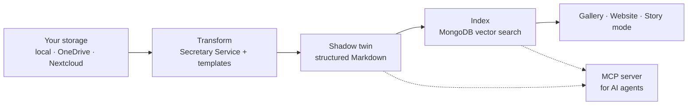

# Common Knowledge Scout

**Turn the files you already have into a knowledge base you can publish and question — without giving up control of the files.**

Common Knowledge Scout (KnowledgeScout) is an open-source web application. It reads audio, video, PDFs, images and web pages from your own storage, turns them into structured Markdown, and makes the result available as a browsable gallery, a public website and a chat that answers with sources.

It is developed by [b\*commonsLAB](https://github.com/bCommonsLAB) as part of the *Common Knowledge Stack*, a research project on commons-oriented knowledge infrastructure.

---

## What it does

| | |
|---|---|
| **Your storage stays the source** | A library points at a folder on a local file system, in OneDrive or in Nextcloud. Originals are never moved or locked in. |
| **Capture and transform** | Audio and video are transcribed, PDFs and images are read, web pages and video playlists are imported. Templates turn the raw text into structured documents with metadata. |
| **Publish** | Each library can have a gallery and a website with its own domain, built from the library's documents. |
| **Ask** | Story mode answers questions from the library's content, cites the documents it used, and can follow answer rules defined per library. |
| **Operate with an agent** | An MCP server exposes the same functions as the user interface, so an AI agent can maintain a library: check coverage, run transformations, publish pages, measure answer quality. |
| **Work together** | Members and invitations, star ratings, and a capture inbox that separates submitting content from publishing it. |
| **Embed and reuse** | The gallery is available as an embeddable component for other websites. One deployment can serve many sites. |

## How it works



1. **Source** – a file in your storage, or a web page.
2. **Transform** – the [Secretary Service](#related-projects) extracts text (transcription, OCR, PDF parsing); a template shapes it into a document with front matter.
3. **Shadow twin** – the result is kept as a Markdown twin of the original. Twins live in MongoDB and can also be written back to your storage as plain files.
4. **Index** – documents are chunked and embedded for retrieval.
5. **Use** – people browse the gallery, read the website, or ask questions in story mode.

## Quick start

### Docker

```bash
docker pull ghcr.io/bcommonslab/commonkno:latest
cp docker-compose.example.yml docker-compose.yml
# edit docker-compose.yml
docker compose up -d
```

### Local development

```bash
git clone https://github.com/bCommonsLAB/CommonKnowledgeScout.git
cd CommonKnowledgeScout
pnpm install
cp .env.example .env.local
# edit .env.local
pnpm dev
```

The application runs at `http://localhost:3000`.

### What you need

- Node.js 20 and pnpm 9.15 (for local development)
- MongoDB with vector search (for example MongoDB Atlas)
- A running Secretary Service — all transformation and language-model calls go through it
- A [Clerk](https://clerk.com/) application for sign-in
- Optional: Azure Blob Storage for published images and media

All settings are described in [Configuration](./docs/operations/configuration.md).

## Documentation

| For | Start here |
|---|---|
| Users | [Use cases](./docs/use-cases/index.md) – step-by-step guides |
| Operators | [Configuration](./docs/operations/configuration.md) – environment variables and services |
| Agent operators | [Operating a library over MCP](./docs/concepts/mcp-library-betrieb.md) (German) |
| Developers | [Architecture overview](./docs/architecture/overview.md), then [module map](./docs/architecture/modul-landkarte.md), [architecture decisions](./docs/adr/) and [contracts](./docs/contracts/) (German) |
| Contributors | [`AGENTS.md`](./AGENTS.md) – repository conventions, tests, branching |

The documentation is also built with MkDocs and served by the application under `/docs`.

> Most internal documentation is written in German. The use cases and this README are in English.

## For developers

- **Stack:** Next.js 15 (App Router), React 18, TypeScript, Tailwind CSS, shadcn/ui, Jotai, TanStack Query, Clerk, MongoDB.
- **Layout:** a pnpm monorepo. The application lives in `src/`; shared code and feature modules live in `packages/` (`@ks/shell`, `@ks/module-explorer`, `@ks/module-story`, `@ks/embed`, `@ks/viewers`, `@ks/ui` and others).
- **Storage abstraction:** all file access goes through one `StorageProvider` interface, so features never depend on a specific backend. See [storage abstraction](./docs/contracts/storage-abstraction.md).
- **MCP server:** a Streamable HTTP endpoint at `/api/mcp/mcp`, authenticated with a personal account key. Every tool calls the same function as the user interface.
- **Desktop:** an Electron shell in `electron/` (`pnpm electron:dev`).
- **Checks:** `pnpm test` and `pnpm lint`.

## Related projects

- **Secretary Service** – the Python service that performs transcription, OCR, PDF extraction and language-model calls for KnowledgeScout.

## License

This repository uses a dual-license model:

- **Source code** – [GNU Affero General Public License v3.0](./LICENSE). You may use, modify and distribute the code as long as you publish your modifications under the same license. If you run a modified version as a web service, you must make its source code available to the users.
- **Documentation, texts, slides and media** – [Creative Commons BY-NC-SA 4.0](./LICENSE_CONTENT.txt). You may share and adapt these materials for non-commercial purposes with attribution and under the same license. Commercial use requires written permission.

When reusing material from this repository, please include:

> "Common Knowledge Stack by Peter Aichner (B\*commonsLAB), licensed under CC BY-NC-SA 4.0 / AGPL v3."

## Contributing

Non-commercial collaboration in the spirit of commons and open research is welcome: pull requests, feedback and local experiments.

For partnership or academic collaboration, contact **peter.aichner@crystal-design.com**.
