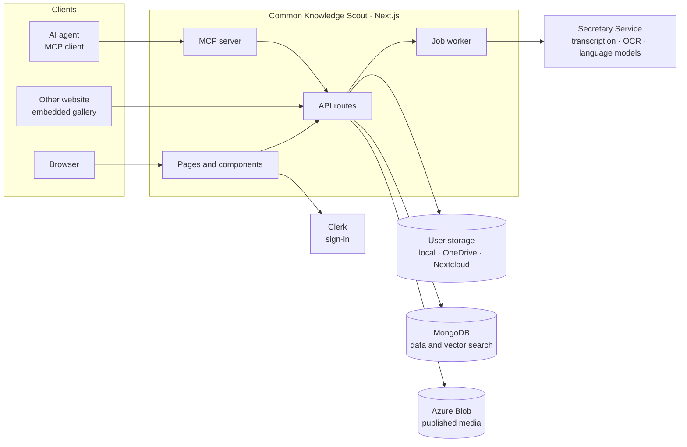
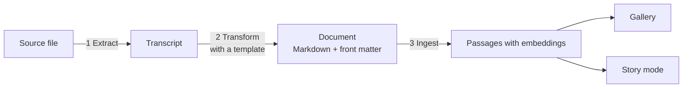

# Architecture overview

This page describes how Common Knowledge Scout is built: the services it needs, how the code is organised, and the decisions that shape it. It is the entry point for developers; the detailed documents it links to are in the repository and mostly written in German.

## The system and its neighbours

| Component | Role |
|---|---|
| **Common Knowledge Scout** | A Next.js application (App Router). It serves the interface, the API, the MCP server and runs the job worker in the same process. |
| **Secretary Service** | A separate Python service. It performs transcription, text recognition, PDF and office extraction, and every call to a language model. The application holds no model provider key. |
| **User storage** | The folder a library points at. Source files stay here and are never moved. |
| **MongoDB** | Libraries, documents, shadow twins, jobs, question log, and the vector index used for retrieval. |
| **Azure Blob Storage** | Optional. Holds images and media of published documents so that they can be served without access to the user's storage. |
| **Clerk** | Sign-in and user management. |

## How the code is organised

The repository is a pnpm monorepo.

| Location | Content |
|---|---|
| `src/app/` | Pages and API routes |
| `src/components/`, `src/lib/` | Interface components and server logic of the application |
| `packages/` | Shared code and feature modules, imported as `@ks/*` |
| `electron/` | The desktop shell |
| `extensions/knowledgescout/` | The Claude Desktop extension that connects to the MCP server |
| `template-samples/` | Example templates |
| `docs/` | Contracts, architecture decisions, plans and this documentation |

The packages are layered. A package may import from the layers below it, not from those above.

| Layer | Packages | Content |
|---|---|---|
| Shared | `@ks/contracts`, `@ks/util`, `@ks/ui`, `@ks/i18n`, `@ks/viewers`, `@ks/api-client` | Types, interface primitives, translations, Markdown rendering, a typed API client |
| Shell | `@ks/shell` | Providers, navigation, and the mapping from a host name to a site |
| Modules | `@ks/module-explorer`, `@ks/module-story` | The gallery and story mode, each with its components and API namespace |
| Embedding | `@ks/embed` | Gallery and story mode as one component for other React applications |

Moving code from `src/` into packages is ongoing work. The target layout and the order of the moves are described in the [module map](https://github.com/bCommonsLAB/CommonKnowledgeScout/blob/master/docs/architecture/modul-landkarte.md).

## Storage abstraction

All access to files goes through one interface, `StorageProvider` (`src/lib/storage/types.ts`), with an implementation for the local file system, OneDrive and Nextcloud. A provider is obtained from `StorageFactory`, on the server through `getServerProvider()`. Features do not ask which backend a library uses; only the settings forms do, to show the right fields.

Credentials for OneDrive and Nextcloud belong to a user account as a *storage connection*. They are encrypted with AES-256-GCM before they are stored.

Rule: [storage abstraction](https://github.com/bCommonsLAB/CommonKnowledgeScout/blob/master/docs/contracts/storage-abstraction.md).

## From file to answer

**Jobs.** Each processing request becomes a job in MongoDB. A worker that starts with the server claims jobs, calls the Secretary Service and receives the result through a callback. Several instances can share one database when each has its own pool ID. All requests enter through one endpoint, `POST /api/pipeline/process`, and choose which of the three phases to run and whether to overwrite existing results.

**Shadow twin.** The transcript and the transformed document of a source are its shadow twin. Twins are stored in MongoDB, one collection per library. A library can also keep a mirror as Markdown files in a folder named `_<source file name>` next to the source, so that agents and other tools can read them. The database is the truth for generated twins; export and import between the two are explicit actions, not a permanent synchronisation.

**Front matter.** The metadata of a document is flat: `snake_case` keys on one level, compatible with Obsidian. One serialiser writes it.

**Index.** Ingestion writes three kinds of records into the library's vector collection: one metadata record per document, the passages with their embeddings, and chapter summaries with their embeddings. The gallery reads the metadata records. Filter fields are copied onto the passages so that a search can be filtered directly. The embedding model and its dimension are set per library.

**Answering.** A question is embedded and matched against the passages with MongoDB vector search, limited by the active filters and, for visitors, to published documents. The best passages go to the language model with the question, the reader's perspective and the library's answer rules. Answers are stored in a question log that also serves as cache.

Rules: [pipeline](https://github.com/bCommonsLAB/CommonKnowledgeScout/blob/master/docs/contracts/contracts-story-pipeline.md), [shadow twin](https://github.com/bCommonsLAB/CommonKnowledgeScout/blob/master/docs/contracts/shadow-twin-contracts.md), [ingestion](https://github.com/bCommonsLAB/CommonKnowledgeScout/blob/master/docs/contracts/ingestion-contracts.md), [chat](https://github.com/bCommonsLAB/CommonKnowledgeScout/blob/master/docs/contracts/chat-contracts.md).

## One deployment, many sites

A site is a configuration, not a separate build. The application resolves the host name of a request to a library and renders that library's website at `/`, without the navigation of the application. Embedding in another website uses `@ks/embed`, which talks to the same API and serves public content only.

## MCP server

The MCP server is a Streamable HTTP endpoint at `/api/mcp/mcp`. A request is authenticated with a personal account key and runs as that user. Each tool is a thin layer over the function the interface calls, so behaviour and validation are the same on both paths. Tools that change something require a reason and write it to an action log.

## Principles

| Principle | Meaning |
|---|---|
| **No silent fallbacks** | An invalid or missing value causes an error or an explicit log entry. It is never replaced by a default without notice. |
| **The interface does not know the storage backend** | Features use the provider interface. |
| **Capture and publish are separate** | Submitted content goes to an inbox first. Publishing is a separate, permission-checked step. |
| **Machine work counts as accepted** | People mark what is wrong instead of confirming what is right. |
| **Public repository** | Documentation describes the application, not a particular library, organisation or person. |

## Architecture decisions

| ADR | Decision | Status |
|---|---|---|
| [0001](https://github.com/bCommonsLAB/CommonKnowledgeScout/blob/master/docs/adr/0001-event-job-vs-external-jobs.md) | Event jobs and external jobs are separate domains | Active |
| [0002](https://github.com/bCommonsLAB/CommonKnowledgeScout/blob/master/docs/adr/0002-galerie-sterne-ohne-clerk-read.md) | Gallery stars come from MongoDB, not from Clerk | Active |
| [0004](https://github.com/bCommonsLAB/CommonKnowledgeScout/blob/master/docs/adr/0004-capture-publish-entkopplung-inbox-modell.md) | Capture writes to an inbox; publishing is a separate job | Active |
| [0006](https://github.com/bCommonsLAB/CommonKnowledgeScout/blob/master/docs/adr/0006-beweislast-umdrehen-werkbank-kuration.md) | Curation marks errors instead of confirming results | Active |
| [0007](https://github.com/bCommonsLAB/CommonKnowledgeScout/blob/master/docs/adr/0007-modularisierung-monorepo-schale-module.md) | Monorepo with a shell, modules and shared libraries | Active |
| [0008](https://github.com/bCommonsLAB/CommonKnowledgeScout/blob/master/docs/adr/0008-deployment-ziele.md) | One deployment, many sites; embedding serves public content only | Active |
| [0011](https://github.com/bCommonsLAB/CommonKnowledgeScout/blob/master/docs/adr/0011-zusammenarbeit-in-stufen.md) | Collaboration in stages; co-creators work with the owner's storage access | Accepted, in progress |
| [0012](https://github.com/bCommonsLAB/CommonKnowledgeScout/blob/master/docs/adr/0012-sterne-zahl-oeffentlich-namen-privat.md) | Star counts can be public; names stay private | Accepted |
| [0003](https://github.com/bCommonsLAB/CommonKnowledgeScout/blob/master/docs/adr/0003-wizard-schema-template-trennen.md), [0009](https://github.com/bCommonsLAB/CommonKnowledgeScout/blob/master/docs/adr/0009-library-foederation.md), [0010](https://github.com/bCommonsLAB/CommonKnowledgeScout/blob/master/docs/adr/0010-retrieval-profile.md) | Separate wizard and schema template; federation of libraries; retrieval profiles | Proposed |

ADR 0005 (co-creators with their own storage access) is postponed; ADR 0011 replaces its direction.

## Working on the code

Conventions, checks and branching rules are in [`AGENTS.md`](https://github.com/bCommonsLAB/CommonKnowledgeScout/blob/master/AGENTS.md). The current state of the work is in [`docs/STAND.md`](https://github.com/bCommonsLAB/CommonKnowledgeScout/blob/master/docs/STAND.md).
